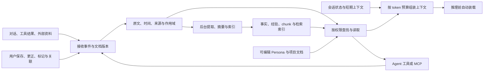

# memfxxk 的 Agent Memory 技术调研

调研日期 2026-11-25。Mem0 对应“Memory Zero”，这里将“Latte”理解为 Letta（原 MemGPT）。项目现状以 GitHub 默认分支和官方文档为准，算法与实验以原论文为准。

memfxxk 可以做成独立于 Agent 框架的记忆服务。同一段交互保留原文和时间，随后可生成分别用于检索、个性化与任务复用的记忆。用户可以明确保存、更正、标记重要和手动关联记忆，让自己的判断影响保存与召回。调用方可以在请求模型前自动装载记忆，也可以让 Agent 按需搜索、读取和写入。Persona 用可编辑的 Markdown 管理，短期上下文有独立预算，向量检索可以直接用。首版可以把这些路径全部跑通，再用实际任务决定哪里需要自动归纳、图谱和模型内部记忆。

## 1. memfxxk 要管理的记忆

| 记忆用途 | 典型内容 | 写入与使用 |
| --- | --- | --- |
| 工作记忆（短期） | 近期对话、当前计划和步骤、待处理工具结果、会话摘要 | 随任务更新。保留必要的会话状态供恢复，按 token 预算装载最近消息和摘要 |
| 情景记忆（长期） | 一次对话、一段工具轨迹、一个项目决策 | 以可定位的原文和时间存档。按会话、时间或任务搜索，可展开相邻证据 |
| 语义记忆（长期） | 用户偏好、项目事实、实体之间的关系 | 从原文提取或由用户写入。保留来源、有效时间和更正历史 |
| Persona 与用户画像 | Agent 身份与行为风格、用户的稳定偏好、项目约定 | 用有版本的 Markdown 管理。核心内容常驻，详细页按需打开，身份、用户画像和项目各有作用域 |
| 程序性记忆 | 已验证的步骤、解决故障的方法、失败模式、可复用技能 | 从带结果的任务中提炼。以后遇到相似任务时召回，并结合来源、适用条件和当前可用工具使用 |
| 外部知识 | PDF、代码、Wiki、文档 chunk | 连接器或 API 导入，给 chunk 保留来源和版本。与用户记忆共同参与检索，分别受来源权限约束 |

期限、用途、表示、作用域和读取时机可以独立组合。例如“示例项目只用 Python 3.12”可以在一条更正事件里留原文，成为一条带有效期的事实，在 `project.md` 中呈现，并同时进入关键词和向量索引。这个划分借鉴了综述把记忆的载体、功能和演化过程分开讨论的方式。 [Memory in the Age of AI Agents](https://arxiv.org/abs/2512.13564)

## 2. GitHub 与产品实现

### 记忆服务与存储

| 项目 | 机制 | 对 memfxxk 的参考 |
| --- | --- | --- |
| **Mem0** | 2025 论文先提取事实，再结合召回的旧记忆选择 ADD、UPDATE、DELETE 或 NOOP，另有图谱变体。v3 改为单次提取、自动写入只追加，结合语义、关键词及实体信号检索。OSS 检索信号取决于后端和配置，内置图记忆在托管平台。 | 对标独立 SDK 和可换存储的入口，版本对比时把旧论文、v3 OSS 与托管平台分开。 [GitHub](https://github.com/mem0ai/mem0) · [2025 论文](https://arxiv.org/html/2504.19413v1) · [OSS 迁移](https://github.com/mem0ai/mem0/blob/main/docs/migration/oss-v2-to-v3.mdx) · [平台迁移](https://github.com/mem0ai/mem0/blob/main/docs/migration/platform-v2-to-v3.mdx) |
| **Zep / Graphiti** | 从原始 episode 增量构建实体、事实边和来源关系，结合语义、关键词与图遍历。事实具有业务有效时间，另有系统记录时间。Graphiti 是可自托管的图构建和查询库，Zep 提供托管的 Context Graph。 | 处理“现在是什么、以前是什么、证据是什么”，以及实体间的多跳关系。 [Graphiti GitHub](https://github.com/getzep/graphiti) · [Zep 文档](https://help.getzep.com/graph-overview) · [论文](https://arxiv.org/abs/2501.13956) |
| **Hindsight** | `retain` 提取经历与外部事实，`recall` 并行做语义、BM25、图和时间检索，融合后重排，`reflect` 根据记忆推理。还有后台观察归纳。 | 分开存储、找证据与生成综合推断。复用并行召回和检索预算的接口思路。 [GitHub](https://github.com/vectorize-io/hindsight) · [Recall](https://hindsight.vectorize.io/developer/api/recall) · [Reflect](https://hindsight.vectorize.io/developer/reflect) · [论文](https://arxiv.org/abs/2512.12818) |
| **Supermemory** | 对话生成事实和画像，文件可用于原文检索，统一在命名空间下提供搜索与静态、动态画像。SDK 等组件公开，本地服务由单独的非公开代码库发布二进制。 | 给调用方分别提供可直接装载的画像与带证据的查询结果。 [GitHub](https://github.com/supermemoryai/supermemory) · [API 参考](https://api.supermemory.ai/reference) · [本地部署](https://github.com/supermemoryai/supermemory/blob/main/apps/docs/self-hosting/overview.mdx) |
| **Cognee** | 导入文档与交互，构建实体、关系和向量索引。支持领域 ontology 和按数据集检索。 | 研究文档、会话、工单如何进入同一套可定制的知识组织流程。 [GitHub](https://github.com/topoteretes/cognee) · [Recall](https://docs.cognee.ai/core-concepts/main-operations/recall) |
| **MemTensor MemOS** | 项目提供统一的记忆管理 API、多 MemCube 组装、混合检索，以及工具轨迹和多模态等数据入口。论文把明文、激活和参数记忆放入同一生命周期框架。 | 参考记忆隔离、分享和调度。模型内部能力的部署条件以相应实现为准。 [GitHub](https://github.com/MemTensor/MemOS) · [论文](https://arxiv.org/abs/2507.03724) |
| **BAI-LAB MemoryOS** | 短、中、长期的层级存储，在交互中更新对话片段、用户画像与知识。 | 给刚发生但值得暂存的事件留出缓冲层，积累到足够证据后再归纳。 [GitHub](https://github.com/BAI-LAB/MemoryOS) · [论文](https://arxiv.org/abs/2506.06326) |
| **Honcho** | 记录消息和事件，通过后台推理更新对用户、Agent 等参与者的描述，可读会话上下文、画像或查询洞察。 | 为长期画像提供独立的更新策略，让推断与具体说话人关联。 [GitHub](https://github.com/plastic-labs/honcho) |
| **TencentDB Agent Memory** | 可通过兼容协议的代理为现有 Agent 接入记忆，另有 Memory Hub 管理团队的共享记忆资产。 | 验证把模型请求地址改到网关后，能否以较少宿主改动接入 memfxxk。 [GitHub](https://github.com/TencentCloud/TencentDB-Agent-Memory) |

### 文档记忆与 Agent 宿主

| 项目 | 机制 | 对 memfxxk 的参考 |
| --- | --- | --- |
| **Letta / MemGPT** | 原 MemGPT 用函数调用在主上下文与外部存储之间调度。当前 Letta 代码在 `letta-code`。其 MemFS 把记忆投影为 Git 工作目录，核心文件装入 system prompt，其他目录通过索引和文件工具按需打开。 | Persona 与人类画像可读、可改、可回溯，Agent 和记忆维护进程可以共用同一套文档。 [MemGPT 论文](https://arxiv.org/html/2310.08560) · [当前 GitHub](https://github.com/letta-ai/letta-code) · [MemFS](https://docs.letta.com/concepts/memfs) |
| **EverOS / EverMemOS** | 论文用 MemCell 保存有意义的片段、用 MemScene 组织相关记忆。当前 EverOS 以 Markdown 为内容真源，SQLite 和 LanceDB 支持内部状态与检索，文档说明了索引重建。 | 研究可移植文件和派生索引如何共存，以及手工编辑后如何同步索引。 [GitHub](https://github.com/EverMind-AI/EverOS) · [存储流程](https://github.com/EverMind-AI/EverOS/blob/main/docs/how-memory-works.md) · [EverMemOS 论文](https://arxiv.org/abs/2601.02163) |
| **OpenViking** | 用 `viking://` 组织资源、记忆与技能。L0 摘要、L1 概览是目录级索引信息，L2 是正文。支持范围限定、向量检索及会话感知搜索。 | 给大量项目资料、技能包和记忆提供可导航路径，先取摘要，再读原文。 [GitHub](https://github.com/volcengine/OpenViking) · [层级](https://docs.openviking.ai/en/concepts/03-context-layers) · [检索](https://docs.openviking.ai/en/concepts/07-retrieval) |
| **OpenClaw** | 有 Agent 身份与风格文件、用户画像、`MEMORY.md` 和每日记忆笔记，并提供 `memory_search`、`memory_get`。 | 给不同文件各自的写入者、装载时机与上下文预算。 [GitHub](https://github.com/openclaw/openclaw) · [记忆文档](https://docs.openclaw.ai/concepts/memory) · [系统提示词](https://docs.openclaw.ai/concepts/system-prompt) |
| **Claude Code** | `CLAUDE.md` 承载维护者给出的指令。启用 auto memory 时，启动加载 `MEMORY.md` 的有限前缀，主题文件按需读。 | 把用户维护的规则和 Agent 学到的笔记放在有明确来源的位置。 [官方文档](https://code.claude.com/docs/en/memory) |
| **Claude-Mem** | 从宿主捕获会话和工具行为，旁路 Agent 提炼观察，下次会话先给简短索引，再按需读历史细节。 | 参考开发 Agent 的项目接续和渐进式召回。 [GitHub](https://github.com/thedotmack/claude-mem) |
| **AgentScope ReMe** | Markdown、frontmatter 和 wikilink 持久化，结合 BM25、可选向量和链接扩展。 | 参考普通文件可编辑、索引可重建的本地工作区形态。 [GitHub](https://github.com/agentscope-ai/ReMe) |
| **memU** | 当前项目以跨 Agent 的个人 Wiki 为入口，后台任务整理会话经验和可复用技能。 | 比较按主题增长的个人 Wiki 和每轮自动提取事实的维护体验。 [GitHub](https://github.com/NevaMind-AI/memU) |

### 框架接入与独立后端

| 组件 | 机制 | 对 memfxxk 的参考 |
| --- | --- | --- |
| **LangGraph / LangMem** | Checkpointer 按线程持久化 Agent 状态。长期 Store 按命名空间存取。LangMem 提供 Agent 主动调用的搜索、管理工具，以及后台记忆管理。 | 分开会话恢复、跨会话检索与后台写入。 [LangGraph 文档](https://docs.langchain.com/oss/python/langgraph/add-memory) · [LangMem GitHub](https://github.com/langchain-ai/langmem) |
| **Google ADK** | Memory Service 有通用的存取接口。官方示例同时支持由宿主预加载和由模型触发的记忆工具。 | 同一个记忆服务同时服务自动注入和 tool calling。 [官方文档](https://adk.dev/sessions/memory/) |
| **LlamaIndex Memory** | 近期消息配合静态文本、事实提取和向量块管理长期内容，并控制送入模型的 token。 | 参考工作记忆的预算、消息迁移及可插拔长期表示。 [官方文档](https://developers.llamaindex.ai/python/framework/module_guides/deploying/agents/memory/) |
| **pgvector** | PostgreSQL 内支持向量近邻和索引，可与原文、来源、时间及权限字段放在同一数据库。关键词检索可用 PostgreSQL 全文搜索。 | 适合作为首版默认后端，便于同一事务写入元数据和索引任务。 [GitHub](https://github.com/pgvector/pgvector) · [PostgreSQL 全文搜索](https://www.postgresql.org/docs/current/textsearch-controls.html) |
| **Qdrant** | 独立向量库，可组合稠密、稀疏向量和元数据过滤，并对多路候选融合。 | 当检索需要独立扩展时，以同一套记忆和元数据做第二个索引适配器。 [GitHub](https://github.com/qdrant/qdrant) · [混合查询](https://qdrant.tech/documentation/search/hybrid-queries/) |

MCP 可以作为记忆工具的标准接入协议，工具背后的存储和权限由 memfxxk 管理。Mem0 旧的 OpenMemory MCP 已停止维护并从主仓移除。 [MCP Tools 规范](https://modelcontextprotocol.io/specification/2025-11-25/server/tools) · [维护状态](https://github.com/mem0ai/mem0/issues/6082) · [移除记录](https://github.com/mem0ai/mem0/pull/6530)

## 3. 论文中的关键机制

| 方向 | 论文机制 | 转成 memfxxk 可验证的问题 |
| --- | --- | --- |
| **工作区与换入换出** | **MemGPT** 让 Agent 主动管理有限主上下文，必要时调用函数从外部取回内容。**Generative Agents** 从记忆流按相关性、新近性与重要性拿观察，并通过反思得到更高层记录。 | 自动装载与按需找证据分别对延迟、任务接续和调用预算有什么影响？ [MemGPT](https://arxiv.org/abs/2310.08560) · [Generative Agents](https://arxiv.org/abs/2304.03442) |
| **分段与多级压缩** | **SeCom** 按语义主题切会话并研究压缩对检索的影响。**RAPTOR** 用嵌入、聚类和逐层摘要建树，在不同粒度查询。**LightMem** 组合轻量分段和分层记忆，安排离线更新。 | 用同一批历史对比按轮、按会话、按主题的 chunk，以及摘要加原文回读，观察证据召回率与写入成本。 [SeCom](https://arxiv.org/abs/2502.05589) · [RAPTOR](https://arxiv.org/abs/2401.18059) · [LightMem](https://arxiv.org/abs/2510.18866) |
| **关联与多跳** | **A-MEM** 把交互变成带上下文的笔记并增量建立链接。**HippoRAG** 用图和 Personalized PageRank 找相关联的证据，**HippoRAG 2** 进一步改进图与原文段落之间的连接和检索。 | 在跨项目、多实体、跨时间的问题中，图扩展能否找到纯向量和关键词搜漏的证据？ [A-MEM](https://arxiv.org/abs/2502.12110) · [HippoRAG](https://arxiv.org/abs/2405.14831) · [HippoRAG 2](https://arxiv.org/abs/2502.14802) |
| **后台归纳与遗忘** | **Sleep-time Compute** 在请求到来之前利用空闲计算准备上下文。**MemoryBank** 用遗忘曲线启发记忆更新与保留。**Hindsight** 把已存事实与基于事实的反思分开。 | 在写路径异步提取、去重和下沉摘要，量化成本、索引可见时间与需要原文回读的比例。用时效和使用记录辅助保留策略。 [Sleep-time Compute](https://arxiv.org/abs/2504.13171) · [MemoryBank](https://arxiv.org/abs/2305.10250) · [Hindsight](https://arxiv.org/abs/2512.12818) |
| **经验与协作** | **Reflexion** 把失败反思供下一次尝试参考。**ExpeL** 从任务经验抽取规则并检索过往案例。**Voyager** 累积可执行技能。**G-Memory** 研究多 Agent 的层级记忆。 | 保存“场景、动作、结果、前置条件、证据”。用后续任务的成功率和错误复发率评估技能与团队共享。 [Reflexion](https://arxiv.org/abs/2303.11366) · [ExpeL](https://arxiv.org/abs/2308.10144) · [Voyager](https://arxiv.org/abs/2305.16291) · [G-Memory](https://arxiv.org/abs/2506.07398) |
| **可学习的记忆策略** | **Memory-R1** 用强化学习训练管理记忆和利用记忆的模型。**Mem-α** 研究 Agent 如何在复杂记忆结构中学习写入策略。 | 先记录哪些读写动作帮助了任务。取得稳定基线和训练数据后，再比较规则、提示词与学习策略。 [Memory-R1](https://arxiv.org/abs/2508.19828) · [Mem-α](https://arxiv.org/abs/2509.25911) |
| **原文搜索与任务差异** | **ReFind** 在原始聊天上做词法搜索，Agent 可调整查询、时间范围并展开上下文，在其对话实验中有竞争力。**Harness the Memory** 在受控框架中发现，适合事实问答的大量召回在顺序决策任务中可能降低表现。 | 保留一条强原文基线。按任务比较自动注入多少内容，以及给 Agent 多少次自主搜索机会。 [ReFind](https://arxiv.org/abs/2608.12888) · [Harness the Memory](https://arxiv.org/abs/2608.15008) |

## 4. 外置记忆的接入方式

### 在模型请求前后接入 memfxxk

| 接入 | 调用时机 | 给模型的内容 |
| --- | --- | --- |
| **常驻文档** | 会话启动或每次组装上下文 | 有明确作用域、版本和长度上限的 Persona、用户画像、项目约定 |
| **自动召回** | 宿主在推理前调用 memfxxk，可放在 SDK、中间件或兼容模型协议的网关 | 与当前请求相关的事实、原文或经验，带时间及来源，按 token 预算截取 |
| **Tool calling / MCP** | Agent 发现信息不足时调用，可追加搜索条件和回读原文 | 工具结果里返回候选、来源、时间、作用域和可继续读取的 ID |
| **自动捕获与后台写入** | 一轮结束、工具完成或会话归档时 | 保存消息、动作与结果。后台工作器生成后续可读的事实、摘要、画像候选或经验 |

这四条路径可以使用同一组记录。启动装载稳定偏好，每轮自动给少量强相关证据，遇到多跳或歧义问题就让 Agent 自己缩小范围并读取全文。Google ADK 提供自动与按需加载示例，Letta 展示常驻与按需文档，TencentDB 展示代理接入。 [ADK Memory](https://adk.dev/sessions/memory/) · [Letta MemFS](https://docs.letta.com/concepts/memfs) · [TencentDB GitHub](https://github.com/TencentCloud/TencentDB-Agent-Memory)

### 让模型内部读取外部存储或状态

| 路线 | 机制 | 接入条件 |
| --- | --- | --- |
| **RETRO** | 根据局部 token 相似度检索外部文本 chunk，通过模型的分块 cross-attention 使用它。 | 需要支持这条注意力路径的模型和对应的检索语料。 [RETRO](https://arxiv.org/abs/2112.04426) |
| **Memorizing Transformers / LongMem** | 前者在模型层通过近邻查找先前的内部键值表示。后者让冻结的主干编码记忆，由侧网络读取历史。 | 需要控制模型和推理过程，能够拿到并管理内部表示。 [Memorizing Transformers](https://arxiv.org/abs/2203.08913) · [LongMem](https://arxiv.org/abs/2306.07174) |
| **Infini-attention** | 在注意力层维护压缩状态，结合局部注意力与更早段落的压缩记忆。 | 使用支持该机制的模型，测试长序列的保真与状态成本。 [Infini-attention](https://arxiv.org/abs/2404.07143) |
| **Larimar / M+** | Larimar 增加可控制、可快速更新的情景记忆。M+ 扩展 MemoryLLM 的隐空间记忆并加入长期检索。 | 使用对应检查点或训练方案，单独测更新、读取与删除语义。 [Larimar](https://arxiv.org/abs/2403.11901) · [M+](https://arxiv.org/abs/2502.00592) |
| **Titans** | 推理期间更新神经记忆模块，让注意力利用更早的历史。 | 需要支持推理期写入的架构，实测吞吐、状态隔离和长程任务效果。 [Titans](https://arxiv.org/abs/2501.00663) |
| **Engram / 参数编辑** | Engram 在模型架构中对训练所得的静态记忆进行条件查表。MEMIT 通过批量编辑权重改变事实关联。 | 针对自有模型评估可控更新与回退。用户记忆的逐条编辑和来源查询仍可由文本服务提供。 [Engram](https://arxiv.org/abs/2601.07372) · [MEMIT](https://arxiv.org/abs/2210.07229) |

vLLM 的前缀缓存和 LMCache 属于推理加速，复用已经计算的 KV 表示可以节省重复输入的 prefill。memfxxk 可以配合这种缓存，将 Persona 等稳定输入放在前面，并独立管理事实的版本和读取。适配内部记忆时，再按模型、检查点和作用域管理对应状态。 [vLLM Prefix Caching](https://docs.vllm.ai/en/latest/features/automatic_prefix_caching/) · [LMCache](https://docs.lmcache.ai/)

## 5. memfxxk 建议架构

### 用户主动管理记忆

用户可以在对话里说“记住这件事”，也可以在记忆列表里找到已有记录，查看原文、修改内容或调整它在个人、项目等范围内的优先级。Letta 的记忆文件支持直接编辑和后台整理，ReMe 会沿 Markdown 链接扩展检索，ChatGPT 的记忆来源界面支持纠正及相关性反馈。 [Letta Memory & Dreaming](https://docs.letta.com/configuration/memory) · [ReMe Memory Search](https://github.com/agentscope-ai/ReMe/blob/main/docs/en/memory_search.md) · [ChatGPT 记忆来源](https://help.openai.com/en/articles/8590148-memory-in-chatgpt)

| 用户操作 | 对保存和召回的影响 |
| --- | --- |
| **记住或更正** | 直接保存用户写下或从原文选中的内容，返回可跨会话读取的记录 ID，并保留来源、作用域和写入者。更正产生新版本，历史证据可以按时间回读。 |
| **标记重要** | 在容量清理和摘要整理时保留用户选中的记录。在指定范围内查询相关主题时，优先召回标为重要的候选。 |
| **固定到上下文** | 在用户指定的范围内，把选定内容装到预留的上下文区域。例如某项目每次开会话都加载它的发布约定。 |
| **关联两条记忆** | 用户可把决策与依据、失败与修复关联起来。检索命中其中一条时，可以带回另一条作为补充证据，也能从记忆列表直接跳转。 |

显式标记由用户改动。自动去重、摘要与索引重建继承用户选择，自动提取遇到与用户确认相冲突的内容时保留证据并提出更正。用户可以取消重要标记、解除固定、删除关联或遗忘记录。记忆列表可以按作用域、来源、重要和固定状态筛选，并查看哪条记忆为何进入了模型上下文。

首版可在授权范围内检索重要项，再和普通关键词、向量候选合并，只提升与当前问题相关的候选。固定项按自己的 token 预算装载。手动关联用数据库关系表存储，检索命中时按需要展开一跳，并检查关联两端的可见范围。

### 数据模型与读取

| 对象 | 职责 |
| --- | --- |
| `MemoryEvent` | 保存消息、工具调用结果、导入文档版本或用户管理操作。至少带原始来源、写入者、作用域、事件时间、记录时间和幂等键。原文可按权限回读。 |
| `MemoryRecord` | 可检索记录，类型可为 chunk、episode、fact、summary、lesson。带稳定 ID、来源 ID 和位置、作用域及状态。用户标记按记录与标记的作用域保存。事实可带业务有效期、版本关系以及推断或确认状态。 |
| `MemoryRelation` | 两条记录之间的关联，带两端 ID、关系用途、创建者及来源事件。用户主动建立的关联可追溯到对应操作。 |
| `MemoryDocument` | 可编辑 Markdown，含路径、用途、作用域、修订版本和装载策略，支持手动维护 `persona.md`、`user.md`、`project.md`。通过 API 提交修订，也可带上基础版本从文件导入修订。 |
| `SessionState` | 保存运行进度与工作记忆，包含近轮窗口、摘要、必要的工具状态和对应的事件位置。可用来在重启后恢复上下文。 |
| `ContextBundle` | 调用方即将给模型的内容，包含常驻文档、固定项、工作记忆和选中的证据。记录各项来源、入选原因和 token 数，便于查看重要标记或关联如何影响召回。 |

- **写入**从原文落库开始，后台任务再提取事实、建向量和关键词索引。首版对话按轮切分，检索结果可展开同会话的相邻轮次。外部文档按章节切分并保留原文位置，导入时可选仅索引 chunk。重试使用幂等键与来源版本。索引更新前，直接保存的记忆仍可按 ID 读取，当轮上下文可使用刚收到的原文。
- **检索**先由服务确认组织、用户、Agent、项目和会话的可见范围。首版查询并行跑关键词和语义召回，按名次融合，再按需做应用级重排。返回时核验现有记录的版本和可见状态。中文和中英混合资料用专门样本比较词法分词、代码标识符和 embedding 表现。
- **更新**支持显式更正和后台提议。来源明确的更正更新当前事实，历史事实保留原证据与有效期。矛盾或缺少时间时，系统可保留双方来源待确认。Persona 由有权限的编辑者修改，自动提炼的偏好可生成可审阅的修订。
- **遗忘**覆盖停用与删除。停用让普通召回排除过时记录，历史查询仍可按日期查找。硬删除先撤销可见性，再处理原文、派生事实、索引与缓存。后台任务写回前验证来源代次，避免迟到任务重新生成已删除的记忆。
- **生成上下文**给 Persona、近期消息、摘要和召回证据各自的预算，保留出处和时间。角色指令使用明确授权的文档，外部资料和历史工具结果带来源标记作为证据。需要更多细节时，Agent 可通过 ID 读取原文窗口。

例如 10 月 8 日用户说项目已迁到 Python 3.12，10 月 10 日才导入这条记录。当前查询应找到 3.12，问 10 月 1 日的版本可以回到旧事实。若问题是“10 月 9 日系统当时知道什么”，查询只使用彼时已记录的事实版本。因此时间模型需要为每个版本保留业务有效区间 `valid_from` / `valid_to`，以及系统接收该版本的时间 `recorded_at`。

### 调用入口

| 操作 | 用法 |
| --- | --- |
| `ingest` 与 `remember` | 前者写入事件或外部文档，后者写入用户明确要保存的内容，共用作用域和幂等语义 |
| `search` 与 `get` | 按查询、类型、作用域和时间找证据，再按 ID 展开明细及来源 |
| `list_memories` 与 `patch_memory` | 按作用域筛选和浏览，按版本更正内容、调整重要标记或固定状态 |
| `link_memories` 与 `unlink_memories` | 建立或移除两条记录之间的关联，验证操作权限并记录来源 |
| `build_context` | 输入请求、会话和预算，返回可装载到模型请求的上下文与引用 |
| `patch_document` | 用修订版本编辑 Persona 或项目页，可读回历史版本 |
| `forget` | 由有权限的调用方停用或删除记录，跟踪受影响的来源与派生项 |

HTTP 和 SDK 提供完整操作，首版可用 CLI 或宿主的记忆列表直接操作。Agent 工具先暴露 `memory_search`、`memory_get` 和 `memory_remember`，代办用户管理操作时使用宿主传来的用户身份和授权。一个 PostgreSQL 实例放会话、事件、文档版本、记录、关联及 pgvector 索引。模型、embedding 和重排按配置替换，Graphiti 一类的图谱以及外部向量库从同一批有来源的记录构建。

## 6. 评测与验收

| 基准 | 能测什么 | 何时用 |
| --- | --- | --- |
| **LongMemEval** | 跨会话信息提取、多会话推理、时间推理、知识更新与应当拒答的问题。 | memfxxk 首轮的主基准，按类别记录结果。 [官方代码与数据](https://github.com/xiaowu0162/LongMemEval) · [论文](https://arxiv.org/abs/2410.10813) |
| **LoCoMo** | 长期对话上的证据问答与时间、多跳推理等任务。 | 对齐多篇论文的对话评测，明确 QA 子集和打分版本。 [ACL 论文](https://aclanthology.org/2024.acl-long.747/) |
| **MemoryAgentBench** | 按轮输入时的准确检索、测试时学习、长程理解、选择性遗忘。 | 评估写入、更新与矛盾处理，按时序重放数据。 [论文](https://arxiv.org/abs/2507.05257) |
| **PersonaMem-v2** | 在对话中发现隐含偏好并对用户做个性化选择。 | 单测 Persona 与画像质量，观察模型回答或行动有没有应用偏好。 [论文](https://arxiv.org/abs/2512.06688) |
| **AMA-Bench** | Agent 在长轨迹中的状态、动作、观察、工具输出和因果关系。 | 开始保存工具结果和工作经验时使用。 [ICML 论文](https://proceedings.mlr.press/v306/zhao26bs.html) · [代码](https://github.com/AMA-Bench/AMA-Bench) |
| **LongMemEval-V2** | 从大量 Web 操作轨迹收集关于界面、状态、工作流和失败模式的证据。 | 验证以后能否从历史经验生成可用 runbook，并在新任务中回读证据。 [论文](https://arxiv.org/abs/2605.12493) |

用同一批输入跑五组对照。第一组只看当前会话，第二组在模型窗口允许时读完整历史，第三组做原始 chunk 的关键词、向量和混合检索，第四组让 Agent 自主搜原文并回读相邻轮次，第五组加入被测的提取、画像、图谱或归纳机制。受控比较每次只改一项，固定生成模型、embedding、数据切分、时间边界、judge 和评分方式，记录注入 token 和工具调用预算。完整历史另记实际 token 和延时。 [MemDelta](https://arxiv.org/abs/2606.29914) · [跨场景诊断与 AutoMEM](https://aclanthology.org/2026.aacl-long.211/)

- **效果**记录证据 Recall@K、包含时间与更正的答案准确率、引用正确率、无证据时的拒答表现、个性化采纳率与后续任务成功率。把“候选里有证据”和“模型正确使用了证据”各自量化。
- **成本**分别记录写入、查询和后台管理的模型调用数、token、耗时和存储量。在线查询记录 p50/p95，写入记录从接收到可搜的延迟。 [Harness the Memory](https://arxiv.org/abs/2608.15008)
- **产品行为**用可控的中英混合数据验收会话接续、跨项目隔离、并发更正、历史版本回读、文档修订冲突、索引重建和删除生效。加一组带失败与修复结果的工具轨迹，测第二次跑相似任务时是否正确复用。
- **用户管理**验收显式保存可跨会话读取，重要标记提高相关候选的排名，固定项在指定范围内装载，手动关联能带回有权限的证据。完成自动整理和索引重建后复跑这些场景，再检查取消标记、解除固定、移除关联是否生效。

项目方分数要带上版本和配置。例如 Mem0 README 的 v3 高分使用托管平台与特定召回预算，直接用于评估本地 OSS 选型会混入配置差异。此报告的比较基于公开实现、文档与论文，memfxxk 的效果和成本需要按上述协议实测。 [Mem0 评测说明](https://github.com/mem0ai/mem0#new-memory-algorithm-april-2026)

## 7. 开工顺序

| 阶段 | 可交付结果 | 验收场景 |
| --- | --- | --- |
| **1 · 把读写闭环跑起来** | 事件与短期会话、可版本化 Persona 文档、原文入库及 Postgres/pgvector 检索、SDK 自动装载、Agent 工具、基线评测脚本。用户能浏览、保存、更正、标记重要、固定和关联记忆。 | 用户标记一条失败记录为重要，并关联修复方案。新会话查到这类问题时，Agent 优先召回失败记录，能沿关联查到修复和原文。 |
| **2 · 自动提取与版本演化** | 异步事实提取、摘要、去重、当前值和历史时点查询、删除传播及可观测性。 | 连续更正后，按现在和过去取到对应证据。即使有后台整理、重试或索引重建，用户的选择仍可从记忆列表和召回结果验证。 |
| **3 · 对复杂任务增加表示** | 实体与关系检索、带验证结果的程序性记忆、团队共享、文件导入导出及 MCP 或网关适配。 | 图谱在多跳题上带来可测提升，经验在重复工具任务上提高成功率。对没有收益的任务使用原文和混合检索。 |
| **4 · 探索推理内部与多模态** | 按模型接入 KV 或隐状态实验后端，并扩展图像、音频等证据表示。 | 用相同任务比较文本注入与模型侧记忆的效果和成本，验证模型状态的作用域与生命周期。 |

首个可演示场景可以用一个开发 Agent。它将一次对话与工具执行保存在 memfxxk，用户从中选了一条重要的 CI 失败记录并关联已验证的修复。隔天继续排查时，Agent 从会话状态恢复进度，遇到相似故障就从长期记忆召回这两条证据。用户修改并固定项目的发布约定后，下一轮自动装载新版本，仍可按时间查出旧决定。
