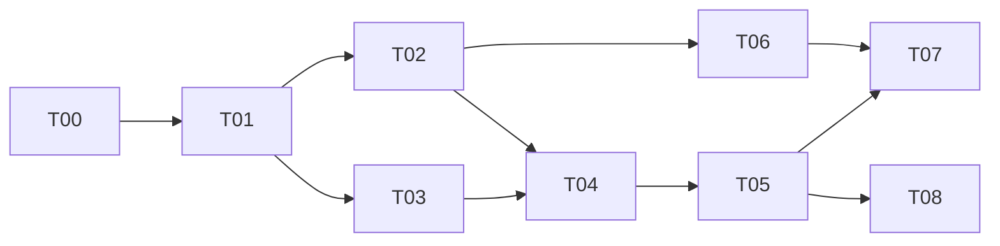

# memfxxk 路线图

状态：草案，2026-11-25。架构契约见 [architecture.md](architecture.md)，Codex 委托见 [codex/](codex/README.md)。

## 总体节奏

| 里程碑 | 目标 | 退出条件（全部满足才进入下一阶段） |
| --- | --- | --- |
| **M0 地基** | 仓库骨架、全量 M1 表结构、作用域与鉴权、测试基础设施 | `docker compose up` + `uv run pytest` 全绿；迁移可升可降；作用域隔离测试通过 |
| **M1 读写闭环 + 基线** | 原文入库、混合检索、用户管理、文档、会话、上下文组装、SDK/CLI/MCP、LongMemEval 基线 | 见下方“M1 完成定义” |
| **M2 长对话与记忆演化** | 通用 Harness 接口、按预算装载、滚动摘要、异步事实提取、半主动管理、去重、双时间查询、删除传播、可观测性 | 长对话经过多次压缩仍能延续任务并遵守预算；knowledge-update 与 temporal-reasoning 相对 M1 最强基线有可测提升，其他类别不退化；删除与重放测试通过 |
| **M3 复杂任务表示** | 实体关系检索、程序性记忆、团队共享、Markdown 工作区导入导出、模型网关、Qdrant 适配 | 每项机制单独过评测闸门（见下），没有收益的不进主路径 |
| **M4 探索** | KV / 隐状态实验后端、多模态证据 | 研究性质，不设产品退出条件 |

[M2 实施计划](#m2-实施计划)基于已跑通的 M1 烟测和长对话需求。正式评测使用补齐后的 M1 基线，M1 的全量评测、压测和试用继续按原退出条件跟踪。

## M1 任务拆分

| 任务 | 内容 | 依赖 | 可并行 |
| --- | --- | --- | --- |
| [T00](codex/T00-foundation.md) | 骨架、配置、全量 schema、作用域/鉴权、测试基础设施 | — | — |
| [T01](codex/T01-ingest-and-indexing.md) | 事件写入、turn 记录、分词、嵌入 Provider、作业队列与 worker | T00 | — |
| [T02](codex/T02-retrieval.md) | lexical + vector + important 通道、RRF、关联展开、get/window | T01 | 与 T03 并行 |
| [T03](codex/T03-user-management.md) | remember、patch（版本/标记）、link、forget、list、审计事件 | T01 | 与 T02 并行 |
| [T06](codex/T06-retrieval-eval.md) | LongMemEval 加载与检索指标（无 LLM） | T02 | 与 T03/T04 并行 |
| [T04](codex/T04-documents-sessions-context.md) | 文档修订、会话状态、build_context、bundle 追踪 | T02, T03 | — |
| [T05](codex/T05-sdk-cli-mcp.md) | 工具定义、Python SDK、CLI、MCP server | T04 | — |
| [T07](codex/T07-qa-eval.md) | LongMemEval 问答对照组 G1–G4 与成本记录 | T05, T06 | 与 T08 并行 |
| [T08](codex/T08-acceptance-demo.md) | 产品行为验收套件 + 演示场景 e2e + 使用文档 | T05 | 与 T07 并行 |

## M1 完成定义

已完成固定 50 题的确定性向量证据横评，并在同一题集的前六题上用本地 BGE 完成语义烟测。近期原文、memfxxk 和 Mem0 OSS 使用相同的时间截止点。可查看 [评测结果](../eval/results/m1-smoke/README.md) 和 [复跑命令](developer-manual.md#evidence-comparison)。

首轮真实模型问答已覆盖固定 50 题的四组对照，以及六道 BGE 题的上下文装载与工具调用。详见 [真实问答报告](../eval/results/m1-smoke/qa-real.md)。

1. T00–T08 全部合入，`uv run pytest` 全绿（含 integration/e2e，需 docker 里的 PG）。
2. **演示场景自动化通过**（T08）：开发 Agent 的一次排障会话入库 → 用户把一条 CI 失败标为重要并关联修复 → 新会话从 session state 恢复进度，遇到相似故障召回这两条（经由关联）→ 用户修改并固定发布约定 → 下一轮自动装载新版本，旧版本仍可按版本号读回。
3. **手动 dogfood**：通过 MCP 把 memfxxk 接到一个真实开发 Agent（Claude Code 或 Codex）上用一周，记录问题清单。
4. **基线数据入库**（`eval/results/` 下有带配置清单的结果）：
   - LongMemEval_S 检索：lexical / vector / hybrid 的 session 级与 turn 级 Recall@{5,10,20}，按问题类型分列。
   - LongMemEval_S 问答：G1（无历史）、G3（hybrid 注入，固定预算）、G4（Agent 自主搜索，固定调用上限）准确率；G2（全历史）在 oracle 子集或上下文足够时补跑。
   - 每组的注入 token、工具调用数、模型 token、延时。
5. **性能**：完整 LongMemEval_S 上记录 search 延时。规模压测目标为约 25 万 turn，search 不含查询嵌入的 DB+融合耗时 p95 ≤ 100ms。固定 SHA 的 S 清洗版实测解析为 124,366 个 turn。

25 万条合成 turn 的混合检索实测 p95 为 162.15 ms，此项仍待达标。复现命令见 [开发手册](developer-manual.md#m1-implementation)。

## M2 实施计划

目标是一段对话在多次压缩后仍能继续工作，保留用户明确指定的内容、最新决定和可回查的证据。Harness 负责模型调用、整窗预算和压缩时机。memfxxk 负责记忆装载、受托摘要和存储。先在仓库的参考宿主中走通，再用同一份契约接其他宿主。

### 工作拆分和顺序

| 任务 | 交付 | 验收 |
| --- | --- | --- |
| **M2-01 宿主接口与预算** | 扩展 `build_context` 的总预算，保留分段限额。参考 Harness 负责统计固定输入、预留回答和工具空间，并给记忆与摘要分别拨预算。 | 在小窗口的自动测试和 128K 场景验证最终请求不过预算。工具返回后重新计数，重复内容只装一次。 |
| **M2-02 滚动摘要和回查** | 压缩指定的已结束消息范围，返回摘要草案、覆盖范围、原文引用和 token 数。宿主采用后确认提交，摘要成为可检索的派生记录。 | 连续压两次并在中间重启宿主，仍能恢复进度和回查原文。超时、重试和并发写入不会产生重复摘要或推进错误的进度。 |
| **M2-03 MCP 和提示词** | 提供供宿主直接调用的 MCP 接口、结构化结果、错误语义和参考 MCP 客户端。版本化压缩、事实提取和用户指令解析提示词。 | 不依赖模型主动发起调用，参考 Harness 就能完成整轮装载、记录和压缩。SDK 与 MCP 给出一致的结果与作用域。 |
| **M2-04 自动提取与时间演化** | 后台提取事实、去重、维护有效时间与记录时间。冲突进入待审列表，提取结果保留原文来源。 | 同一批历史重复导入是幂等的。能回答「那时什么规则有效」和「系统当时知道什么」，并保留用户确认过的版本。 |
| **M2-05 半主动管理和文档按需读** | 支持用户用自然语言提升或降低优先级、加标签、指定加载方式、关联或更正记录。长文档按标题切块，检索返回对应修订与章节。 | 短规则能常驻，长世界观在需要时才读相关章节。标记、更正、撤销和关联在下一轮可验证，作用域不串。 |
| **M2-06 删除、重放与观测** | 跟踪原文到摘要、事实、文档切块和向量的依赖。删除后清理或重建派生物，异步写回校验代次。记录预算使用、丢弃原因、压缩成本、延时和失败。 | 删除后重建和迟到的作业都无法恢复旧内容。回放同一输入可解释哪些记录入选。观测只记录所需元数据。 |
| **M2-07 对照评测与验收** | 冻结对照组和预算，跑压缩回放、真实长对话和 LongMemEval 时间类题。验证是否值得把新策略设成默认。 | 对比现有装载、候选证据压缩、滚动摘要和优先级；报告正确率、证据保留、每千轮写入成本与端到端延时。 |
| **M2-08 图检索试验** | 混合检索给起点，沿显式关联和已审核事实的共享实体走一到两跳。 | 默认关闭。同一批题报告证据命中与延时，验证隐藏节点和边不会出现在结果里。见 [试验记录](decisions/0001-m2-graph-pilot.md)。 |

先完成 M2-01 至 M2-03 的一条最小路径。Harness 能记录一轮、按预算取记忆、委托一次压缩，再从下一轮续上。M2-04 与 M2-05 可以沿同一接口并行做。删除与重放回归随每种派生记录加入，在 M2-06 汇总。M2-07 从第一条路径开始留数据。

### Harness 调用接口

宿主工具复用 HTTP、Python SDK 和核心领域对象，在 MCP 开启宿主模式时可直接调用。

| 何时调用 | 宿主操作 | 输入与返回 |
| --- | --- | --- |
| 完成一轮或已确认的工具事件入库 | `events_append` | 传会话、原文事件、宿主事件 ID 或重试键。返回已保存的事件 ID 和会话序号。 |
| 每次模型调用前，按需刷新 | `context_build` | 传查询、会话、记忆 token 上限和已在请求里的消息范围。返回装好的记忆、用量、来源和选入原因。 |
| 预算达到宿主的压缩阈值 | `context_prepare_compaction` | 传截止序号、预期会话修订和摘要 token 上限。返回草案、覆盖范围、来源和用量。 |
| 宿主验证并采用草案时 | `context_commit_compaction` | 传草案 ID。返回持久摘要及版本，超时后可以用同一草案 ID 重试。 |

Harness 负责 system/developer 提示、实际暴露的工具定义和 MCP 指令、当前消息、进行中的工具轮次和最终 token 计数。引用只读已经结束的旧轮次；保护当前任务、近期原文和还在等结果的工具调用。压缩生成完成时先返回草案。宿主校验预算、调用结果配对和源版本后记录采用决定，再提交摘要；失败时保留原内容和压缩进度，必要时用相同幂等键恢复提交。用小窗口自动触发同一流程，避免回归测试每次都发送 128K。

宿主工具由参考 Harness 程序直接调用。给模型的工具沿用 `memory_search`、`memory_get`、`memory_remember`，另提供有权限的优先级、标签和关联操作。两类工具使用各自的授权与暴露配置。宿主工具返回结构化字段，模型工具返回简洁的证据和来源；MCP 调用超时、返回截断和权限错误都有明确处理路径。自动调用由宿主生命周期触发，MCP prompt 可另外提供由用户点选的「检查记忆」「更正决定」等模板。 [MCP Tools](https://modelcontextprotocol.io/specification/2025-11-25/server/tools) · [MCP Prompts](https://modelcontextprotocol.io/specification/2025-11-25/server/prompts)

### 摘要、事实和用户管理怎样共用

- 保存后的摘要有范围、版本、来源和作用域，可以搜索到再跳回原文。下一次只压新增区间和需要带入的上一版摘要；长期有效的记忆仍能从原文和用户确认版本追溯。摘要可提供提取线索，事实发布时校验原始证据。删除源内容后，摘要、事实和索引一起失效或重建。
- 事实记录区分生效时间与系统记录时间。例如 5 月 10 日才获知「规则其实从 5 月 1 日生效」，这两个时间都要能查。时态不明确时保留来源和待确认状态。未经确认的提取结果遇到用户更正，作为提议进入待审流程。
- 用户优先级先实验五级，标签和加载方式单独记录。优先级影响候选排序和预算竞争，标签用于筛选，加载方式支持短规则常驻、长文档带短说明或按需读章节。已有 `important` 和 `pinned` 的兼容规则在 M2-05 冻结。用户明确说「把故障 A 关联到修复 B」时，解析成可核对的结构化操作；自动发现的关联先作为建议。

### 提示词要交付什么

| 提示词 | 必须传入 | 必须产出 |
| --- | --- | --- |
| 压缩旧消息 | 已结束的原文范围、上一版摘要、用户标记、最新更正、摘要上限 | 最新决定、未完成任务、相关工具结果、原文引用、覆盖范围；区分确定事项和待核实事项 |
| 事实提取 | 有出处的消息、可见的现有事实和时间 | 按事实划分的候选、出处、已知生效时间、可能重复项或冲突提议；没有可靠证据可返回空列表 |
| 解析管理请求 | 用户原话、候选记录、允许的操作和作用域 | 具体目标、优先级或标签变更、关联或版本操作、歧义提示；清楚的授权对应可撤销的变更 |

例如压缩提示词可以写「根据所给历史整理任务状态。保留用户最新确认的决定、未完成的动作和能解释下一步的工具结果。为关键条目附上源事件 ID；遇到冲突，标明版本与来源。」出参用 schema 校验，预算和权限用代码校验。配置及版本随评测落盘，记录内容作为数据处理。

### 收尾验收

- **长对话**。中途把「周五发布」改成「周二发布」，经历至少两次压缩和一次恢复。后续采用有效的新决定、接续待办，还能回查旧版本；整次请求保持在宿主预算内。另一条用例维护较长世界观，只有写到相关场景才装入对应章节。
- **压缩**。固定真嵌入召回候选，同一模型对照较宽预算的原文、1,500 token 截断和同预算的证据压缩，分别报告证据是否找回、是否装入和最后是否答对。长材料的外部补测先挑 LongBench v2 的长对话和代码题。 [LongBench v2](https://longbench2.github.io/)
- **原定 M2 指标**。对 LongMemEval 的 knowledge-update 和 temporal-reasoning 与 M1 最强基线做配对比较，并复跑单会话回归。报告压缩与提取的输入/输出 token、查询与作业延时、错误率、每千轮写入成本。确认跨作用域隔离、重放、修订和删除传播。
- **交付**。参考 Harness 示例、工具配置、提示词版本、调用追踪和中英文手册一起更新。M2 图检索采用独立试验开关，生产图谱和代理网关继续按 M3 的退出条件安排。

## M3 实施

| 任务 | 交付 | 验收 |
| --- | --- | --- |
| [T09 程序性记忆](codex/T09-procedural-memory.md) | 保存带失败与验证出处的经验，通过 SDK 和 MCP 复用 | 真实库里验证跨会话复用、作用域隔离和删除传播，再用重复工具任务评估 Agent 第二次成功率 |
| [T10 Markdown 工作区](codex/T10-markdown-workspace.md) | 工作区快照、目录往返、选定经验和原文迁移 | 验证跨项目迁移、冲突回滚、幂等重试和迁移后的证据回查 |
| [T11 团队项目凭据](codex/T11-project-credentials.md) | 为项目成员签发绑定身份的只读或可写凭据 | 验证团队共享、私有记录隔离、撤销与降级 |
| [T12 MCP Harness](codex/T12-mcp-harness.md) | 通用宿主循环接入 MCP，模型和宿主各自调用所需工具 | 验证自动装载、主动管理、原文捕获和重启续跑 |
| [T13 图证据装载](codex/T13-graph-evidence-budget.md) | 让宿主给图证据留额度并回收余额 | 在同一预算下测证据装入与答题收益 |
| [T14 向量适配](codex/T14-qdrant.md) | 可选 Qdrant 向量镜像，沿用数据库权限与删除 | 验证镜像、故障回退、删除传播和部署规模下延时 |
| [T15 模型网关](codex/T15-model-gateway.md) | 可选的非流式文本兼容入口，自动装载和捕获 | 验证上游转发、身份隔离及幂等入库 |

T09 至 T15 已有实现与集成回归。图预算留在可选配置。M2 的长对话和问答收益，以及 M3 的真实重复工具任务与向量性能验证，仍按原门槛验收。

## M1 之后的评测闸门

- **事实提取（M2）**：必须在 knowledge-update、temporal-reasoning 上胜过 G3/G4，且 single-session 类不退化；同时报告每千轮写入成本。
- **图谱（M3）**：只在 multi-session 推理题（及自建跨项目多跳集）上与 G3/G4 比较，提升不显著则只保留为可选检索通道。
- **程序性记忆（M3）**：用一组带失败与修复的重复工具任务（自建 + AMA-Bench），看第二次运行成功率和错误复发率。
- **模型侧记忆（M4）**：同任务比较文本注入与 KV/隐状态的效果与成本。

## 已知风险

| 风险 | 应对 |
| --- | --- |
| `ts_rank_cd` 无 IDF，lexical 通道偏弱 | T06 先量化；必要时换 ParadeDB `pg_search` 或应用侧 BM25（ADR-03） |
| 嵌入成本（LongMemEval_S 约 25 万条） | `embedding_cache` 按内容哈希去重（S 子集的会话在问题间大量重复）；默认用本地 bge-m3 |
| 评测分数与公开数字不可比 | 结果清单固定生成模型、judge、嵌入、切分、K、预算；官方 judge 与自定义 judge 分开标注 |
| 用户显式选择被后台覆盖 | M1 无会改写内容的后台任务；M2 引入时先写回归测试（T08 套件在每次整理后复跑） |
| Windows 开发环境差异 | 使用同一 Docker PostgreSQL 跑本地回归，并由 CI 在 Linux 验证 |
