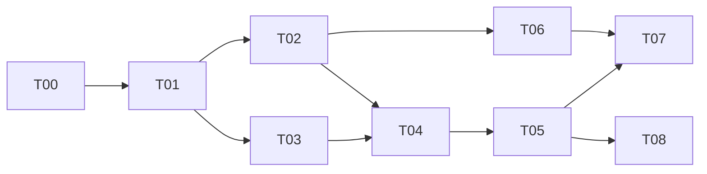

# memfxxk 路线图

状态：草案，2026-11-25。架构契约见 [architecture.md](architecture.md)，Codex 委托见 [codex/](codex/README.md)。

## 总体节奏

| 里程碑 | 目标 | 退出条件（全部满足才进入下一阶段） |
| --- | --- | --- |
| **M0 地基** | 仓库骨架、全量 M1 表结构、作用域与鉴权、测试基础设施 | `docker compose up` + `uv run pytest` 全绿；迁移可升可降；作用域隔离测试通过 |
| **M1 读写闭环 + 基线** | 原文入库、混合检索、用户管理、文档、会话、上下文组装、SDK/CLI/MCP、LongMemEval 基线 | 见下方“M1 完成定义” |
| **M2 自动提取与时间演化** | 异步事实提取、会话摘要、去重、双时间查询、删除传播、可观测性 | LongMemEval 的 knowledge-update 与 temporal-reasoning 类别相对 M1 最强基线有可测提升，其他类别不退化；删除与重放测试通过 |
| **M3 复杂任务表示** | 实体关系检索、程序性记忆、团队共享、Markdown 工作区导入导出、模型网关、Qdrant 适配 | 每项机制单独过评测闸门（见下），没有收益的不进主路径 |
| **M4 探索** | KV / 隐状态实验后端、多模态证据 | 研究性质，不设产品退出条件 |

M2 以后的 Codex 委托等 M1 基线数据出来后再写——要先知道哪些类别弱，再决定提取做到多细。

## M1 任务拆分

| 任务 | 内容 | 依赖 | 可并行 |
| --- | --- | --- | --- |
| [T00](codex/T00-foundation.md) | 骨架、配置、全量 schema、作用域/鉴权、测试基础设施 | — | — |
| [T01](codex/T01-ingest-and-indexing.md) | 事件写入、turn 记录、分词、嵌入 Provider、作业队列与 worker | T00 | — |
| [T02](codex/T02-retrieval.md) | lexical + vector + important 通道、RRF、关联展开、get/window | T01 | 与 T03 并行 |
| [T03](codex/T03-user-management.md) | remember、patch（版本/标记）、link、forget、list、审计事件 | T01 | 与 T02 并行 |
| [T06](codex/T06-retrieval-eval.md) | LongMemEval 加载与检索指标（无 LLM） | T02 | 与 T03/T04 并行 |
| [T04](codex/T04-documents-sessions-context.md) | 文档修订、会话状态、build_context、bundle 追踪 | T02, T03 | — |
| [T05](codex/T05-sdk-cli-mcp.md) | 工具定义、Python SDK、CLI、MCP server | T04 | — |
| [T07](codex/T07-qa-eval.md) | LongMemEval 问答对照组 G1–G4 与成本记录 | T05, T06 | 与 T08 并行 |
| [T08](codex/T08-acceptance-demo.md) | 产品行为验收套件 + 演示场景 e2e + 使用文档 | T05 | 与 T07 并行 |

## M1 完成定义

已冻结一批 50 道 LongMemEval_S 证据题，覆盖全部六种题型。近期原文、memfxxk 和 Mem0 OSS 按同一题集和截止时间比较。复跑命令见 [开发手册](developer-manual.md#evidence-comparison)。

1. T00–T08 全部合入，`uv run pytest` 全绿（含 integration/e2e，需 docker 里的 PG）。
2. **演示场景自动化通过**（T08）：开发 Agent 的一次排障会话入库 → 用户把一条 CI 失败标为重要并关联修复 → 新会话从 session state 恢复进度，遇到相似故障召回这两条（经由关联）→ 用户修改并固定发布约定 → 下一轮自动装载新版本，旧版本仍可按版本号读回。
3. **手动 dogfood**：通过 MCP 把 memfxxk 接到一个真实开发 Agent（Claude Code 或 Codex）上用一周，记录问题清单。
4. **基线数据入库**（`eval/results/` 下有带配置清单的结果）：
   - LongMemEval_S 检索：lexical / vector / hybrid 的 session 级与 turn 级 Recall@{5,10,20}，按问题类型分列。
   - LongMemEval_S 问答：G1（无历史）、G3（hybrid 注入，固定预算）、G4（Agent 自主搜索，固定调用上限）准确率；G2（全历史）在 oracle 子集或上下文足够时补跑。
   - 每组的注入 token、工具调用数、模型 token、延时。
5. **性能**：完整 LongMemEval_S 上记录 search 延时。规模压测目标为约 25 万 turn，search 不含查询嵌入的 DB+融合耗时 p95 ≤ 100ms。固定 SHA 的 S 清洗版实测解析为 124,366 个 turn。

## M1 之后的评测闸门

- **事实提取（M2）**：必须在 knowledge-update、temporal-reasoning 上胜过 G3/G4，且 single-session 类不退化；同时报告每千轮写入成本。
- **图谱（M3）**：只在 multi-session 推理题（及自建跨项目多跳集）上与 G3/G4 比较，提升不显著则只保留为可选检索通道。
- **程序性记忆（M3）**：用一组带失败与修复的重复工具任务（自建 + AMA-Bench），看第二次运行成功率和错误复发率。
- **模型侧记忆（M4）**：同任务比较文本注入与 KV/隐状态的效果与成本。

## 已知风险

| 风险 | 应对 |
| --- | --- |
| `ts_rank_cd` 无 IDF，lexical 通道偏弱 | T06 先量化；必要时换 ParadeDB `pg_search` 或应用侧 BM25（ADR-03） |
| 嵌入成本（LongMemEval_S 约 25 万条） | `embedding_cache` 按内容哈希去重（S 子集的会话在问题间大量重复）；默认用本地 bge-m3 |
| 评测分数与公开数字不可比 | 结果清单固定生成模型、judge、嵌入、切分、K、预算；官方 judge 与自定义 judge 分开标注 |
| 用户显式选择被后台覆盖 | M1 无会改写内容的后台任务；M2 引入时先写回归测试（T08 套件在每次整理后复跑） |
| Windows 开发环境差异 | 全部依赖 docker 里的 PG；路径与换行在 CI（M1 后补）上用 Linux 再验证 |
